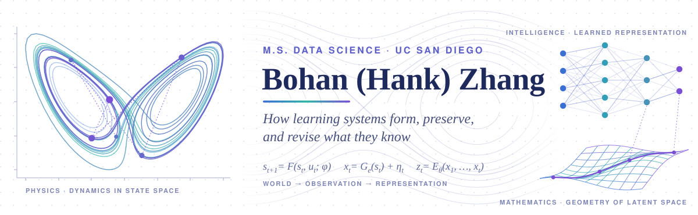
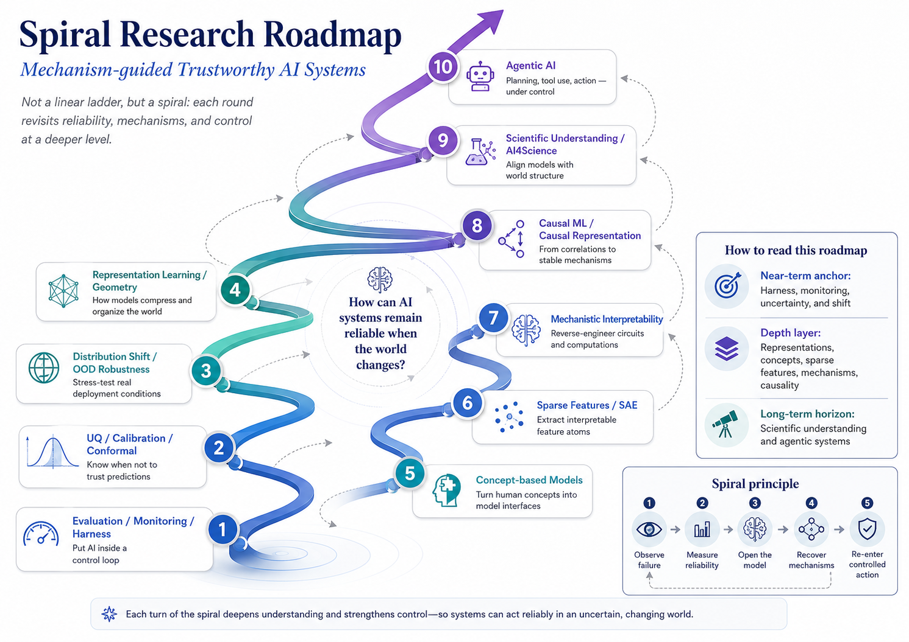

  

  
  
  
  <!-- Add when available:
  
  
  -->

  <em>“Man's greatest concern is to know how he shall properly fill his place in the universe and correctly understand what he must be in order to be a man.”</em> 
  — Immanuel Kant

---

## ◆ What I believe

<table>
  <tr>
    <td width="33%" valign="top">
      <h4>Intelligence is a process, not a store.</h4>
      Memorizing data is not understanding it. Understanding means abstracting patterns into concepts, and revising those concepts when experience no longer fits, sometimes gradually and sometimes all at once. Theory and practice keep correcting each other.
    </td>
    <td width="33%" valign="top">
      <h4>Causality is a commitment, not a given.</h4>
      The physical laws we know barely care about the direction of time. A causal model is a description we choose at some level, and it is justified in practice, by whether it holds up under intervention. Its power comes from added assumptions, which should be made visible.
    </td>
    <td width="33%" valign="top">
      <h4>AI should stay a tool.</h4>
      People set its purpose, check its results, control its process, and answer for its consequences. That is only possible if we can see what a model has learned and what changes inside it.
    </td>
  </tr>
</table>

## ◆ The question this leads to

If intelligence is the revision of concepts, then the key question about a learning system is what it does when new experience arrives:

> **What should a model preserve, what should it adapt, and when should it reorganize its existing representation?**

| Response | When it is appropriate |
|---|---|
| **Preserve** | The underlying system is unchanged, but observation conditions differ |
| **Adapt** | The same structure is present under a new context or task |
| **Expand** | New objects, variables, states, or parameters appear |
| **Reorganize** | The previous representation is fundamentally inadequate |

My current direction is **continual representation learning across changing environments**: keeping the latent structure that environments share, adapting to what is specific to each, and incorporating factors that are genuinely new. I treat distribution shift as a probe of what a model has represented, and I start with simple dynamical systems, where the true state and the kind of change can be controlled.

## ◆ The path: from reliable prediction to revisable representations

I reached this question from a practical one. I first asked *when* a model becomes unreliable, then *why* it does so when its environment changes. Often the model has learned a representation that was sufficient for its training conditions but not structure that stays valid beyond them.

  

| Stage | Question | Work | Status |
|---|---|---|---|
| **1. Reliable prediction** | Where and how do models fail outside their training conditions? | **B.S. thesis:** STGCN forecasting under sensor noise and missing data, with MC Dropout uncertainty <!-- link the repo once it is public --> |  |
| **2. Reliability analysis** | Does the model know when it is wrong? | **[ML Foundations & Evaluation Toolkit](https://github.com/shangversatile/ml-foundations-eval-toolkit):** a from-scratch digit classifier that is 97.8% accurate on clean data falls to 18.2% under a stroke-thickening shift while staying 96.7% confident; robustness learned on synthetic shifts reaches only 58.9% on real hand-drawn digits |  |
| **3. Representation analysis** | What changes inside the model under shift? | CKA and probing on the toolkit's hidden layers |  |
| **4. Continual representation learning** | Can shared structure survive sequential environments? | **[Reliable-AI-Research-Lab](https://github.com/shangversatile/Reliable-AI-Research-Lab):** protocol and hypotheses |  no results yet |
| **5. Identifiability and causal structure** | When do learned latents correspond to real generative factors? | Reading: **[Paper-Reading-Notes](https://github.com/shangversatile/Paper-Reading-Notes)** |  |

<!-- Add after your lab placement is confirmed:
**Currently:** research in the Trustworthy ML Lab (Prof. Lily Weng) on ... -->

<b>More: concepts, experimental setting, evaluation, roadmap, and foundations</b>

 

The full program is in **[research-program.md](./research-program.md)**:

1. What I believe
2. How the question developed
3. The research question
4. Concepts: distribution shift, stability and plasticity, memory
5. Experimental setting: dynamical systems and the first problem
6. Evaluation principles
7. Roadmap and long-term questions
8. Scope and foundations
9. Current work

---

## ◆ Get in touch

I'm glad to talk about continual learning, representation analysis, interpretability, and the philosophy behind them. I'm open to research collaborations and ML research internships.

- **Email:** [boz043@ucsd.edu](mailto:boz043@ucsd.edu)
- **LinkedIn:** [linkedin.com/in/bohan-zhang-0516a1435](https://www.linkedin.com/in/bohan-zhang-0516a1435/)
- **Location:** San Diego, CA · UC San Diego, Halıcıoğlu Data Science Institute

From reliable prediction to continually revisable internal representations.

